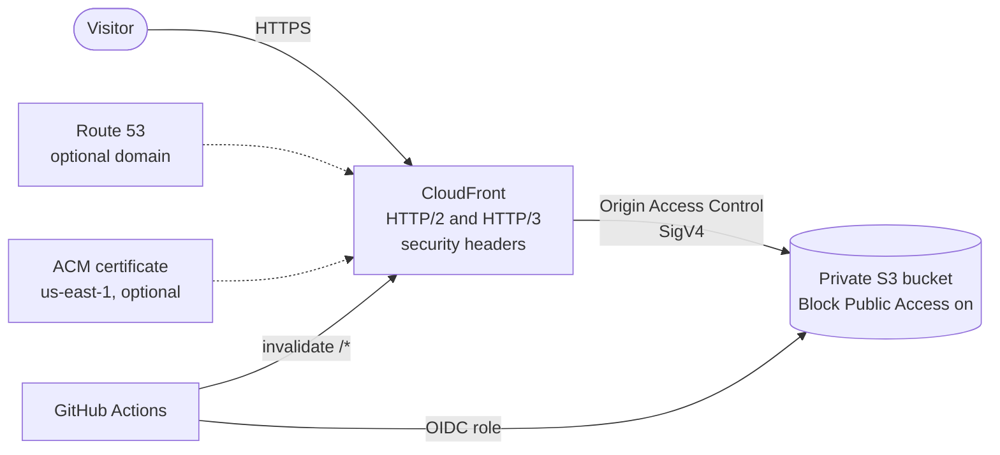
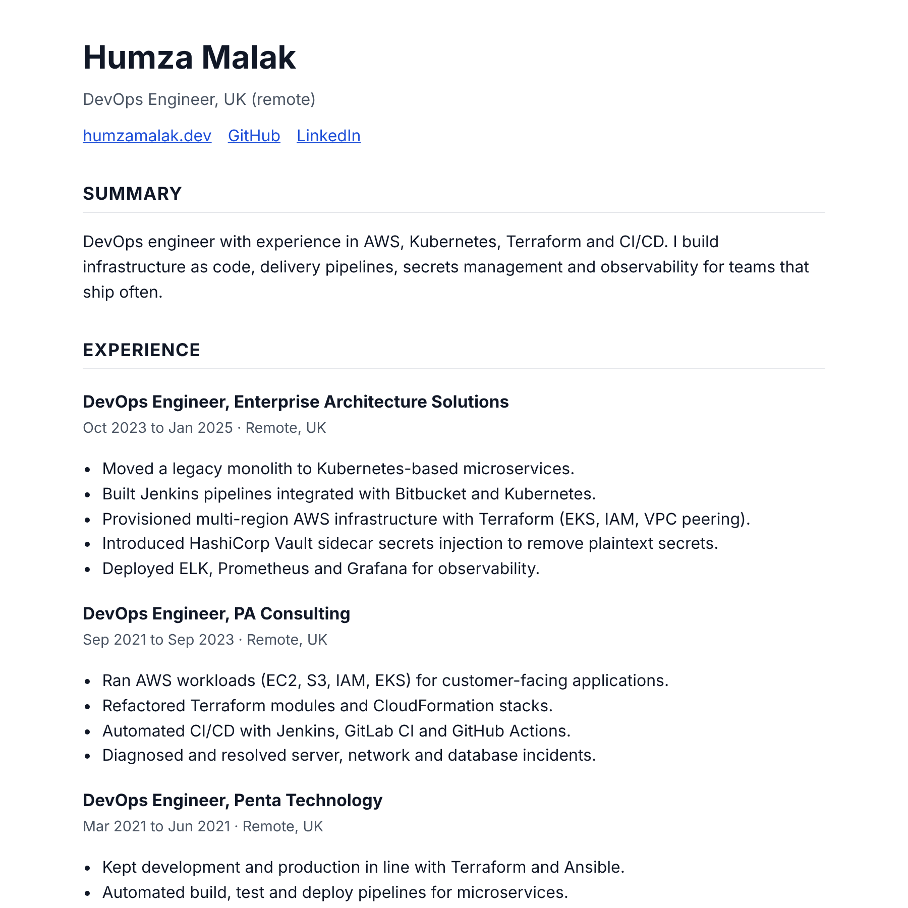

# Résumé Website on S3 and CloudFront


A static HTML résumé served from a **private** S3 bucket through CloudFront. Only CloudFront can read the bucket (Origin Access Control). HTTPS, security headers and an optional custom domain are set up with Terraform. GitHub Actions deploys on every push to `main` with OIDC.

## Architecture



## Demo

Local preview of `site/` (real screenshot):



> **Live site and demo video:** _placeholder. Add the CloudFront URL and a short recording after you deploy._

## Why this design

- **The bucket is not a website.** S3 static website hosting needs a public bucket and serves HTTP only. Here the bucket stays private and CloudFront signs every origin request (OAC). The bucket policy allows only this distribution (`AWS:SourceArn`).
- **Security headers** come from a CloudFront response headers policy: HSTS, `X-Content-Type-Options`, `X-Frame-Options`, `Referrer-Policy` and a strict Content Security Policy. The page has no inline scripts.
- **Missing pages.** Without `s3:ListBucket`, S3 returns 403 for a missing key. CloudFront maps 403 to `/404.html` with status 404.
- **Cheap.** `PriceClass_100` (North America and Europe edge locations) and the managed caching policy.

## Deploy

```bash
cd terraform
terraform init
terraform apply                                  # cloudfront.net address
# or, with your own domain in Route 53:
terraform apply -var domain_name=cv.example.com -var hosted_zone_id=Z0123456789
```

Upload the site:

```bash
aws s3 sync ../site "s3://$(terraform output -raw bucket)" --delete
aws cloudfront create-invalidation --distribution-id "$(terraform output -raw distribution_id)" --paths '/*'
terraform output url
```

For automatic deploys, apply with `-var github_repository=<owner>/<repo>` and set the repository variables `RESUME_DEPLOY_ROLE_ARN`, `RESUME_BUCKET` and `RESUME_DISTRIBUTION_ID` (see `.github/workflows/deploy.yml`).

## Edit the content

Edit `site/index.html`. The roles and dates come from humzamalak.dev. Measured results (percentages, uptime) are left out on purpose. Add them only where you can back them up in an interview.

## Clean up

```bash
terraform -chdir=terraform destroy
```
